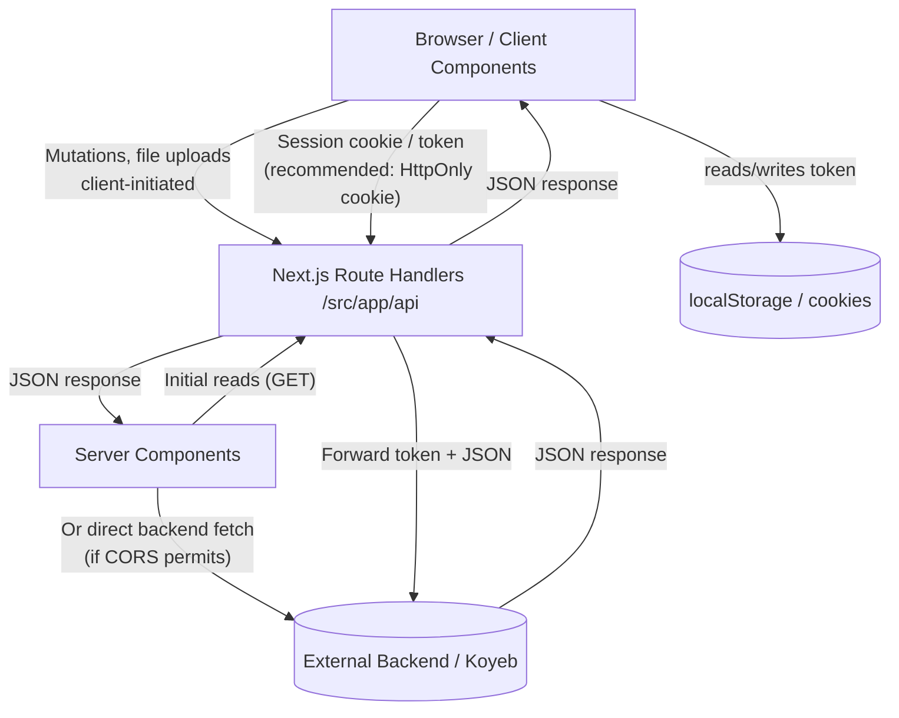
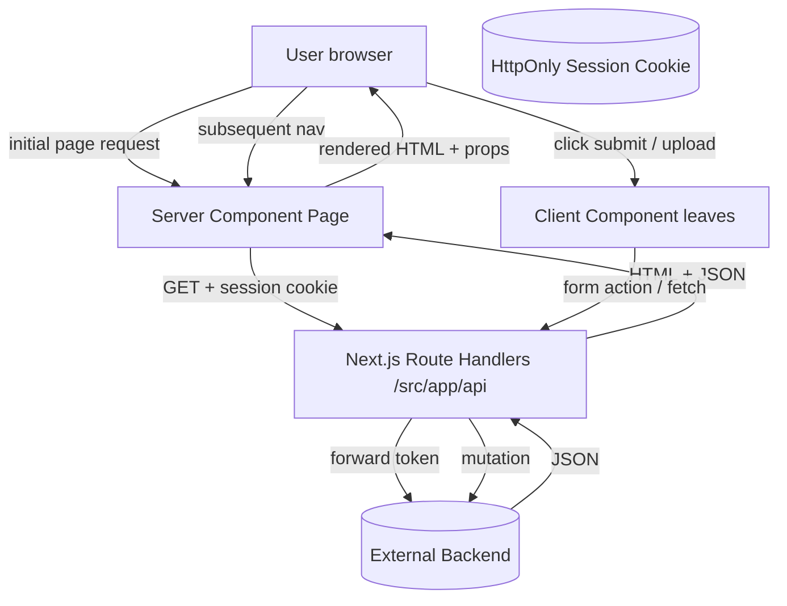

# Next.js Architecture, Performance & Best Practices Audit

**Project:** Zentra (event-management)  
**Location:** `/home/amith/projects/zentra-frontend`  
**Next.js version:** 16.0.7  
**React version:** 19.1.0  
**Router:** App Router (route groups: `(appshell)`, `(auth)`, `(landing)`)  
**Backend:** External API at `BACKEND_URL` (Koyeb), accessed via Next.js Route Handler proxies  
**Audit type:** Analysis and documentation only — no source code was modified

---

## A. Executive Summary

### Overall architectural assessment

The application is built on Next.js 16 (App Router) with React 19, but its architecture is **predominantly that of a traditional React SPA** in which Next.js is used primarily as a bundling/dev server/framework wrapper rather than as a platform leveraging Server Components, server-side data fetching, streaming, or Route Handlers for anything beyond pass-through proxying.

### Does the application follow standard Next.js conventions?

Partially. The project correctly adopts the App Router directory structure and route groups, and the root layout plus landing page are Server Components. However, the entire authenticated application shell (`(appshell)/layout.tsx`) and every page within it are marked `"use client"`, and all data fetching happens in `useEffect` hooks on the client. This inverts the Next.js recommended model, where the default is Server Components and data is fetched on the server.

### Does it behave primarily like a traditional React SPA?

Yes. The authenticated portion of the app behaves like a single-page application:

- The whole app shell is a Client Component, so the server sends minimal HTML and the browser renders everything.
- Initial page data is fetched after hydration via `useEffect` → `apiRequest` → fetch to `/api/*` Route Handlers → proxy to the external backend. This is the classic client-side data-fetching waterfall.
- There are no route-level `loading.tsx` files, no `error.tsx` boundary per route, no `Suspense` boundaries, and no streaming.
- Navigation uses `next/link` and `useRouter`, but since pages are Client Components fetching data client-side, each navigation triggers a fresh client-side request and a loading state rather than progressive server rendering.

### Major strengths

| Strength | Evidence |
|---|---|
| App Router + route groups adopted | `src/app/(appshell)`, `(auth)`, `(landing)` |
| Root layout is a Server Component | `src/app/layout.tsx` (no `"use client"`) |
| `next/font` for font optimization | `src/app/layout.tsx:9-17` (Geist) |
| `next/image` with `priority` on landing hero | `src/app/(landing)/page.tsx:157-164` |
| `BACKEND_URL` is server-only (not `NEXT_PUBLIC_*`) | `.env`; read only in Route Handlers and `api-server.ts` |
| Centralized API endpoint definitions | `src/lib/api/endpoint.ts` |
| Route Handlers forward auth headers and handle timeouts/connection errors | `src/app/api/clients/route.ts:6-65` |
| Auth token cleared on 401 | `src/lib/api/api-client.ts:68-74` |
| Draft/auto-save persistence layer exists | `src/lib/draft/` |
| XSS mitigations (DOMPurify dependency present) | `isomorphic-dompurify` in `package.json` |

### Major weaknesses

| Weakness | Impact |
|---|---|
| Entire app shell is `"use client"` | `src/app/(appshell)/layout.tsx:1` — blocks SSR for all dashboard routes |
| All pages `"use client"` | 15 appshell pages + all auth pages marked client |
| Client-side data fetching via `useEffect` | Every list/detail page fetches after hydration (SPA waterfall) |
| No Server Component data fetching | Zero pages fetch data on the server |
| No Server Actions | All mutations go through client → Route Handler → backend |
| No streaming/Suspense boundaries | No `loading.tsx`, per-route `error.tsx`, or `<Suspense>` |
| Auth token in localStorage | XSS-exposable token storage (`src/lib/secure-storage.ts`) |
| Weak CSP (`unsafe-inline`, `unsafe-eval`) and possibly unwired | `src/proxy.ts`; no `middleware.ts` found |
| No request deduplication/cancellation on the client | Duplicate fetches possible on rapid navigation |

### Bottom-line answers (final assessment preview)

1. **Is this a properly structured Next.js application?** No — it is structurally an App Router project, but architecturally it is a React SPA; it does not use Server Components for data fetching or rendering.
2. **Is it primarily behaving like a traditional React SPA?** Yes — the authenticated shell is fully client-rendered with client-side data fetching.
3. **Is it taking advantage of Server Components effectively?** No — only the root layout and landing page are Server Components; none fetch data.
4. **Is API handling following recommended Next.js practices?** Partially — Route Handlers exist as a BFF proxy layer (appropriate given the external backend), but all invocation is client-side; no Server Component fetching or Server Actions.
5. **Biggest performance bottlenecks?** Client-side initial data fetching on every navigation; full app-shell JavaScript bundle; no streaming or progressive loading.
6. **What should be improved first?** Move list/read pages to Server Components fetching directly from the backend (or via Route Handlers), add `loading.tsx`/`error.tsx` boundaries, and stop marking the whole shell `"use client"`.
7. **Which existing implementations should be retained?** The external-backend BFF proxy via Route Handlers, centralized `API_ENDPOINTS`, `next/font`, `next/image` on landing, root metadata, and the draft/auto-save layer.

---

## B. Existing Architecture

### Current project structure

```
src/
  app/
    layout.tsx                      # Root layout (Server Component)
    globals.css
    error.tsx                       # Root error boundary (Client Component)
    not-found.tsx
    (appshell)/                     # Route group — authenticated dashboard shell
      layout.tsx                    # "use client" — whole shell is client-rendered
      dashboard/page.tsx
      clients/page.tsx
      enquiries/page.tsx
      enquiries/[id]/page.tsx
      estimates/page.tsx
      events/page.tsx
      events/[id]/page.tsx
      bills/page.tsx
      schedules/page.tsx
      inventory/page.tsx
      users/page.tsx
      checklists/page.tsx
      vendors/page.tsx
      reports/page.tsx
    (auth)/                         # Route group — login, forgot-password
      layout.tsx                    # "use client"
      login/page.tsx                # "use client"
      forgot-password/page.tsx      # "use client"
    (landing)/                      # Route group — public marketing page
      page.tsx                      # Server Component
    api/                            # Route Handlers — BFF proxies to external backend
      (auth)/login/route.ts
      clients/route.ts, clients/[id]/route.ts, clients/get/route.ts
      events/route.ts, events/[id]/route.ts, ... (~35 route files)
      enquiries/..., estimates/..., vendors/..., bills/..., expenses/..., ...
  components/
    ui/, ui-old/                    # UI primitives (shadcn-style)
    layout/                         # App-shell header, sidebar, landing header/footer
    enquiries/detail/*              # Enquiry detail sub-components
    billing/*, checklist-modal/*, shared/*
    protected-route.tsx, access.tsx, navigation-loader.tsx
  context/
    app-providers.tsx               # "use client" — ThemeProvider + AuthProvider
    auth.tsx                        # "use client" — AuthProvider (localStorage token)
    theme-provider.tsx              # "use client"
    enquiries.tsx, estimate-prefill.tsx, event-prefill.tsx
  hooks/
    useRequestApi.ts, useClients.ts, useEnquiryDetail.ts, useBills.ts, ...
  lib/
    api/api-client.ts               # Client-side authenticated fetch
    api/api-server.ts               # Server-side proxy utilities for Route Handlers
    api/backend-config.ts           # Hardcoded localhost fallback URL
    api/endpoint.ts                 # Centralized endpoint definitions
    secure-storage.ts               # CryptoJS AES encryption to localStorage
    sanitize.ts, utils/, validations/, draft/
  config/                           # nav.ts, permissions.ts, site.ts
  constants/                        # client.ts, dashboard.ts, enquiry.ts, event.ts, user.ts
  types/                            # Domain TypeScript types
  proxy.ts                          # Security-header middleware-like (not wired — see Finding SEC-04)
```

### Routing approach

- **App Router** with three route groups: `(appshell)`, `(auth)`, `(landing)`.
- Route groups keep URLs clean (e.g., `/login`, `/dashboard`, `/clients`, not `/auth/login`).
- Root `src/app/layout.tsx` redirects `/` → `/login` permanently via `next.config.ts`.
- Dynamic segments used for detail pages: `enquiries/[id]`, `events/[id]`, `clients/[id]`, etc.
- Client-side navigation via `next/link`, `useRouter`, `useSearchParams`, `usePathname`.

### Rendering strategy

| Area | Component type | Renders on | Notes |
|---|---|---|---|
| Root layout | Server Component | Server | Good — `next/font`, metadata |
| Landing page | Server Component | Server | Good — static marketing content |
| Auth layout + pages | Client Component | Client | Needed for `next/image` + interactivity |
| Appshell layout | Client Component | Client | Entire shell client-rendered (suboptimal) |
| All appshell pages | Client Component | Client | Data fetched in `useEffect` after hydration |
| Root `error.tsx` | Client Component | Client | Global fallback only |

There are **no route-level `loading.tsx` files**, no per-route `error.tsx` boundaries, and **no `<Suspense>` or streaming** anywhere in the appshell. `src/app/error.tsx` exists only as a global fallback.

### API handling architecture

1. **Client** calls `apiRequest(endpoint, options)` from `src/lib/api/api-client.ts` (or `useRequestApi` / domain hooks).
2. `apiRequest` reads the Bearer token from encrypted `localStorage` (`zentra_auth`), attaches `Authorization` + `X-Auth-Token` headers, and `fetch`es a Next.js Route Handler URL (e.g., `/api/clients`).
3. On 401, `api-client.ts` clears storage and redirects to `/login`.
4. **Route Handler** (e.g., `src/app/api/clients/route.ts`) extracts the token via `getBackendHeaders`, then `fetch`es the external backend at `BACKEND_URL`, forwards headers, and returns the proxied response to the client.
5. The external backend is the source of truth; the Next.js API routes are a thin BFF/proxy layer (mostly to avoid CORS and to keep `BACKEND_URL` off the client).

### Server vs Client Component usage

- **Server Components:** root layout, landing page only. Neither performs data fetching.
- **Client Components:** entire `(appshell)` tree (layout + all 14 pages), all `(auth)` pages/layout, `error.tsx`, `navigation-loader.tsx`, all providers, and essentially all interactive/modal components.
- `"use client"` is applied at the layout level, which forces every descendant (including purely presentational tables, cards, badges, and modals) into the client bundle.

### State management architecture

- **React Context providers:** `AuthProvider` (auth), `ThemeProvider` (theme), `EnquiriesProvider`, `EstimatePrefillProvider`, `EventPrefillProvider`, `DraftProvider` (auto-save). All wrapped in `AppProviders` (client).
- **Custom hooks:** `useRequestApi` (generic), `useClients`, `useEnquiryDetail`, `useBills`, `useBilling`, `useExpenses`, `useFundAllocations`, `useNotifications`, `useUsers`, `usePagination`.
- **Local state:** `useState`/`useReducer` inside pages and modals for form, modal, filter, and selection state.
- **Persistence:** `localStorage` for auth token (encrypted via CryptoJS), theme, and per-enquiry priority (`zentra:enquiry-priority:<id>`).
- **URL state:** `useSearchParams` used in `estimates/page.tsx` to open version views; `next/navigation` for programmatic navigation.
- No global state library (Redux, Zustand, etc.).

---

## C. Detailed Audit Findings

Finding ID format: `<CATEGORY>-NN`. Severity: Critical / High / Medium / Low.

### C.1 Server vs Client Components

#### ARCH-01 — Entire authenticated app shell is a `"use client"` layout

| Field | Description |
|---|---|
| Severity | High |
| Category | Architecture |
| File | `src/app/(appshell)/layout.tsx:1` |
| Current Implementation | The `(appshell)` root layout begins with `"use client"` and wraps every dashboard page (`ProtectedRoute`, header, sidebar, providers, `Access` guard). All descendants are therefore Client Components. |
| Observation | Marking the shell `"use client"` opts the entire authenticated application out of server rendering. The server emits a minimal shell and the browser must download, parse, and hydrate the full component tree before anything is visible. This is the defining trait of a React SPA, not a Next.js App Router app. `usePathname` and `useAuth` (both client APIs) justify client rendering only for the permission/guard portion, not for layout chrome that could be server-rendered. |
| Recommended Approach | Split the shell: keep a thin Server Component layout for static chrome (sidebar links, header branding) and isolate the client-only concerns (`usePathname`-based permission matching, `ProtectedRoute` redirect, providers requiring client APIs) into smaller Client Component wrappers leafward. Pages that only display fetched data should be Server Components. |
| Expected Benefit | Faster First Contentful Paint, smaller client JavaScript bundle, server-rendered initial HTML for dashboard routes, improved SEO/social sharing for any public-facing dashboard URLs. |
| Risk | Medium — requires refactoring permission logic and provider boundaries; must preserve role-based access behavior and the `Access` guard render pattern. |

#### ARCH-02 — Every appshell page is `"use client"` including read-only list pages

| Field | Description |
|---|---|
| Severity | High |
| Category | Architecture |
| File | `src/app/(appshell)/clients/page.tsx:1`; `estimates/page.tsx:1`; `events/page.tsx:1`; `enquiries/page.tsx:1`; `dashboard/page.tsx:1`; `bills/page.tsx:1`; `inventory/page.tsx:1`; `users/page.tsx:1`; `vendors/page.tsx:1`; `checklists/page.tsx:1`; `schedules/page.tsx:1`; `reports/page.tsx:1`; `enquiries/[id]/page.tsx:1`; `events/[id]/page.tsx:1` |
| Current Implementation | All 14 appshell pages begin with `"use client"` and fetch data in `useEffect` after mounting. Even `dashboard/page.tsx`, which only reads `useAuth` and maps over static `DASHBOARD_STATS`, is a Client Component. |
| Observation | Read-only pages that only display data (clients list, estimates list, dashboard) are forced into the client bundle and fetch data after hydration, producing a loading state and a second network round-trip that could be avoided with Server Component fetching. |
| Recommended Approach | Convert read-only pages (`clients`, `estimates`, `events`, `enquiries`, `dashboard`, `bills`, `inventory`, `vendors`, `users`) to Server Components that fetch data directly (or via Route Handlers) at render time. Keep `"use client"` only for interactive sub-components (modals, filters, inline edit, status toggles), passed as props from the Server Component page. |
| Expected Benefit | Eliminates the client-side loading waterfall for list/detail pages; reduces client JS; initial HTML contains data. |
| Risk | Medium — interactive children must be explicitly `"use client"` and passed as props; data-fetching logic moves from hooks to page components. |

#### ARCH-03 — `useAuth` / `ProtectedRoute` perform client-side authentication gating

| Field | Description |
|---|---|
| Severity | High |
| Category | Security / Architecture |
| File | `src/components/protected-route.tsx`; `src/context/auth.tsx`; `src/app/(appshell)/layout.tsx` |
| Current Implementation | `ProtectedRoute` (`protected-route.tsx:7-34`) checks `isAuthenticated` from `AuthContext` in a `useEffect` and `router.push("/login")` when not authenticated. `AuthProvider` loads the token from `localStorage` on mount (`auth.tsx:47-83`). There is no server-side session check or middleware-based route protection. |
| Observation | Protection is entirely client-side: an unauthenticated user receives the full client bundle and a brief loading spinner before being redirected. Sensitive route HTML is never server-rendered, but more importantly the guard can be bypassed by disabling JavaScript or tampering with client state. There is no middleware (`middleware.ts` does not exist) to enforce authentication at the edge. |
| Recommended Approach | Add Next.js middleware to validate the session/token (e.g., via a signed cookie or a backend verification call) and redirect unauthenticated requests to `/login` before rendering. Keep `ProtectedRoute` as a client-side UX enhancement only. |
| Expected Benefit | Requests to protected routes are rejected at the edge; no client bundle served to unauthenticated users; consistent auth enforcement. |
| Risk | High — introduces middleware and requires a session-verification mechanism backed by the external backend or Next.js; must not break existing login flow. |

#### ARCH-04 — `"use client"` applied to presentational components deep in the tree

| Field | Description |
|---|---|
| Severity | Medium |
| Category | Architecture |
| File | Multiple: `src/components/billing/*`, `src/components/enquiries/detail/*`, `src/components/create-*-modal.tsx`, `src/components/ui/*` |
| Current Implementation | Because the page/layout is `"use client"`, every rendered descendant (tables, badges, avatars, modals, status trackers) is part of the Client Component tree even when purely presentational. |
| Observation | Presentational components that only render props cannot benefit from server rendering and unnecessarily increase the client bundle. There is no server/client component boundary; the boundary is the layout itself. |
| Recommended Approach | Establish explicit Server/Client boundaries: Server Components fetch and pass data down; leaf interactive components (forms, buttons with handlers, modals) are `"use client"` and receive data via props. |
| Expected Benefit | Smaller client bundle per page, better caching of server-rendered HTML, clearer mental model. |
| Risk | Low to Medium — mechanical refactor of component props; no behavior change. |

### C.2 API Handling and Data Fetching

#### API-01 — All data fetching is client-side via `useEffect`

| Field | Description |
|---|---|
| Severity | High |
| Category | API / Performance |
| File | `src/app/(appshell)/clients/page.tsx:172-174`; `estimates/page.tsx:200-202`; `enquiries/page.tsx:186-188`; `src/hooks/useClients.ts:33-35`; `src/hooks/useEnquiryDetail.ts:132-134` |
| Current Implementation | `useClients` (`useClients.ts`) and page-level `fetchClients`/`fetchEnquiries`/`refreshEstimates` are all invoked inside `useEffect(() => { ... }, [])`. `useEnquiryDetail` fetches the detail plus two follow-up calls (event and estimate) all client-side. |
| Observation | Every page performs its initial data load in the browser after hydration. This is the classic SPA pattern: server sends an empty shell, client fetches, user sees a loading state, then content. Next.js App Router recommends Server Components fetch data during server rendering so the initial HTML already contains content. |
| Recommended Approach | Move initial list/detail data fetching into Server Components (pages), calling the backend directly or via Route Handlers. Client-side `useEffect` fetching should be reserved for genuinely client-triggered refreshes (polling, re-fetch after mutation) rather than initial load. |
| Expected Benefit | Eliminates initial-loading waterfall; faster Time to First Byte of meaningful content; reduces client bundle and duplicate requests. |
| Risk | Medium — requires Server Component pages and error/loading boundaries (`error.tsx`, `loading.tsx`) per route. |

#### API-02 — `useRequestApi` stores the last result in hook state, causing re-fetch semantics on each mount

| Field | Description |
|---|---|
| Severity | Medium |
| Category | API / Performance |
| File | `src/hooks/useRequestApi.ts`; `src/app/(appshell)/clients/page.tsx:148`; `enquiries/page.tsx:135` |
| Current Implementation | `useRequestApi` keeps `data`, `loading`, `error` in local `useState`. Each call to `request` overwrites `data`. There is no cache, no deduplication, and no sharing of in-flight requests across components. |
| Observation | If two components on the same page fetch the same endpoint, two requests are issued. There is no stale-while-revalidate, no request deduplication, and no cache invalidation on mutation. |
| Recommended Approach | Introduce request deduplication (e.g., an in-flight promise map keyed by URL) or adopt a client data library (React Query, SWR, or Next.js `cache`) for shared, cached, deduplicated data fetching. At minimum, deduplicate identical concurrent GET requests. |
| Expected Benefit | Fewer duplicate network requests, consistent data across components, simpler loading/error handling. |
| Risk | Low — additive change to the hook layer; existing pages can opt in. |

#### API-03 — `apiRequest` in `api-client.ts` performs a browser-to-Backend-indirect request through Route Handlers for every call

| Field | Description |
|---|---|
| Severity | Medium |
| Category | API / Architecture |
| File | `src/lib/api/api-client.ts:83-105`; `src/app/api/clients/route.ts` |
| Current Implementation | Client `apiRequest` fetches `/api/*` Route Handlers which in turn `fetch` the external backend. Every client page load therefore incurs: browser → Next.js Route Handler → external backend → Next.js → browser. |
| Observation | The Route Handler layer adds a hop and serverless function execution for every read, without adding transformation or aggregation. Since `BACKEND_URL` is server-only and the client already sends the token, direct browser-to-backend calls are possible where CORS allows; the proxy exists primarily to avoid CORS and keep the backend URL secret. |
| Recommended Approach | Keep Route Handlers as the BFF for operations requiring server-only secrets or header transformation. For read operations that do not need server-side transformation, consider Server Components calling the backend directly (if CORS/credentials permit) or keeping the Route Handler but invoking it from Server Components instead of the client. Do not remove Route Handlers where they add value (auth header injection, timeout handling, response normalization). |
| Expected Benefit | Reduced latency for read paths, fewer serverless invocations. |
| Risk | Medium — direct browser-to-backend requires CORS configuration on the backend and exposes the backend URL unless kept behind `NEXT_PUBLIC` (which is undesirable); the current proxy is a legitimate security boundary. Retain proxy for write/mutating operations. |

#### API-04 — `api-client.ts` logs partial auth tokens to the console

| Field | Description |
|---|---|
| Severity | Medium |
| Category | Security |
| File | `src/lib/api/api-client.ts:92` |
| Current Implementation | `console.log("[API Client] Adding auth headers:", authHeader.substring(0, 20) + "...")` writes a prefix of the Bearer token to the browser console. |
| Observation | Logging any portion of an authentication token exposes it in browser DevTools and any client-side logging/remote-logging service. |
| Recommended Approach | Remove the token logging entirely or log only a static marker (e.g., `"[API Client] Adding auth headers: present"`). |
| Expected Benefit | Eliminates token exposure via console logs. |
| Risk | Low — one-line removal. |

#### API-05 — No request timeout or cancellation on the client-side fetch path

| Field | Description |
|---|---|
| Severity | Medium |
| Category | API / Reliability |
| File | `src/lib/api/api-client.ts:44-77`; `src/hooks/useRequestApi.ts` |
| Current Implementation | Client `apiRequest` / `authenticatedFetch` use raw `fetch` with no `AbortController` timeout. Server-side `clients/route.ts` implements `fetchWithTimeout` (5s) but the client path does not. |
| Observation | Slow or hung backend requests leave the client loading indicator indefinitely until the browser/network times out. No way to cancel stale requests on navigation away. |
| Recommended Approach | Add an `AbortController`-based timeout wrapper to the client fetch path and tie request lifetime to component unmount / navigation. |
| Expected Benefit | Predictable loading states, no hung requests, cancellable fetches on navigation. |
| Risk | Low — utility-level addition. |

#### API-06 — Mock/fake data fallback masks backend failures on the estimates page

| Field | Description |
|---|---|
| Severity | Medium |
| Category | Reliability / Data Integrity |
| File | `src/app/(appshell)/estimates/page.tsx:169-194` |
| Current Implementation | When `refreshEstimates` fails (including when the backend is unreachable), the catch block silently substitutes hardcoded draft estimates (`draft-1`, `draft-2`) instead of surfacing an error. |
| Observation | Users are presented with fabricated data that looks real, with no indication the backend failed. This is a data-integrity risk and hides outages. |
| Recommended Approach | Remove the mock fallback; show an error state/toast and allow retry. If offline/draft support is intended, make it explicit and label data as draft/local-only. |
| Expected Benefit | Accurate data representation, visible failure handling, no silent data fabrication. |
| Risk | Low — changes error UX only; backend integration unchanged. |

#### API-07 — Backend URL duplicated across `.env`, `backend-config.ts`, and inline Route Handler fallbacks

| Field | Description |
|---|---|
| Severity | Low |
| Category | Architecture |
| File | `.env:1`; `src/lib/api/backend-config.ts:2`; `src/app/api/clients/route.ts:31` (uses helper) but `events/route.ts:4` uses inline `process.env.BACKEND_URL || "http://localhost:8080"` |
| Current Implementation | `backend-config.ts` hardcodes `http://localhost:8080` (stale default) while `.env` points to Koyeb. Some Route Handlers use `getBackendUrl()` from `api-server.ts`; others (`events/route.ts`) read `process.env` directly with a localhost fallback. |
| Observation | Inconsistent configuration sources; the hardcoded localhost in `backend-config.ts` is dead/misleading if not used. |
| Recommended Approach | Canonicalize on `getBackendUrl()` from `api-server.ts` across all Route Handlers; remove or update `backend-config.ts` to avoid confusion. |
| Expected Benefit | Single source of truth for backend URL, simpler deployment config. |
| Risk | Low — consolidation of existing helpers. |

#### API-08 — `useEnquiryDetail` issues three sequential client fetches on detail load

| Field | Description |
|---|---|
| Severity | Medium |
| Category | API / Performance |
| File | `src/hooks/useEnquiryDetail.ts:99-180` |
| Current Implementation | `fetchDetail` calls the enquiry detail endpoint, then a second `useEffect` calls the event detail endpoint and the estimates-by-enquiry endpoint to derive workflow state and priority — all client-side and sequential. |
| Observation | Three dependent client requests after hydration create a multi-stage loading waterfall on the detail page. This could be a single server-side aggregation or a Server Component fetch. |
| Recommended Approach | Fetch enquiry detail server-side (Server Component page) and aggregate workflow state there, or add a backend endpoint that returns the enriched detail in one response. |
| Expected Benefit | One round-trip instead of three; no client waterfall. |
| Risk | Medium — depends on backend capability; Server Component page conversion required. |

### C.3 Rendering and Performance

#### PERF-01 — No route-level loading or error boundaries

| Field | Description |
|---|---|
| Severity | High |
| Category | Rendering / Performance |
| File | `src/app/(appshell)/*` (no `loading.tsx`/`error.tsx`); only `src/app/error.tsx` exists globally |
| Current Implementation | Next.js convention provides automatic loading and error UI via `loading.tsx` and `error.tsx` per route segment. None exist in `(appshell)`. Pages manage their own `loading` state and show inline spinners/toasts. |
| Observation | Without `loading.tsx`, Next.js cannot stream a shell or show a progressive loading state; without per-route `error.tsx`, errors fall back to the global boundary, losing granular recovery. |
| Recommended Approach | Add `loading.tsx` (Suspense fallback) and `error.tsx` (error boundary) for `(appshell)` list/detail routes. |
| Expected Benefit | Streaming SSR, progressive rendering, graceful per-route error recovery. |
| Risk | Low — additive files; requires Server Component pages to leverage streaming fully. |

#### PERF-02 — No `next/image` optimization in the appshell; `next/image` used correctly on landing

| Field | Description |
|---|---|
| Severity | Low |
| Category | Performance |
| File | `src/app/(landing)/page.tsx:157-164` (good); appshell pages use plain `img`/CSS or unoptimized images |
| Current Implementation | Landing hero uses `<Image priority width={1200} height={600}>` — correct. Appshell components (avatars, banners) do not appear to use `next/image`. |
| Observation | Landing is optimized; the dashboard shell is not audited for image optimization but lacks explicit `next/image` usage in reviewed files. |
| Recommended Approach | Replace `` tags in the appshell with `next/image` where images are served from the app or a configured remote domain. |
| Expected Benefit | Automatic resizing, format optimization (WebP/AVIF), lazy loading. |
| Risk | Low — component-level replacement. |

#### PERF-03 — Client-side pagination and filtering of full datasets

| Field | Description |
|---|---|
| Severity | Medium |
| Category | Performance |
| File | `src/app/(appshell)/clients/page.tsx:176-205`; `enquiries/page.tsx:141-150` |
| Current Implementation | `clients/page.tsx` fetches all clients, then filters/paginates in memory (`useMemo`, `usePagination`). `enquiries/page.tsx` builds a query URL with `page`/`size` but the result handling suggests server-side pagination exists on the backend (`content`, `totalElements`). |
| Observation | If the backend supports pagination (`page`, `size`, `sort`), the client should request only the current page rather than fetching the full list and slicing client-side. `clients/page.tsx` fetches the entire list then paginates locally — wasteful for large datasets. |
| Recommended Approach | Pass pagination/sort/filter parameters to the API and render only the returned page; remove client-side slicing of full lists. |
| Expected Benefit | Smaller payloads, faster renders, scalable list rendering. |
| Risk | Low to Medium — verify backend supports the query params (enquiries already does). |

#### PERF-04 — Custom `NavigationLoader` mimics SPA loading bar instead of Next.js navigation loading

| Field | Description |
|---|---|
| Severity | Low |
| Category | Rendering / Architecture |
| File | `src/components/navigation-loader.tsx` |
| Current Implementation | A client component shows a fake progress bar on `nav-start` custom event and `pathname` change — a synthetic SPA-style navigation indicator. |
| Observation | Next.js App Router already provides `useRouter().isPending` and `loading.tsx` for navigation loading states. The custom loader duplicates this and adds client JS. |
| Recommended Approach | Replace with Next.js `loading.tsx` + `usePathname`/router pending state, or remove if redundant. |
| Expected Benefit | Less client code, idiomatic Next.js navigation UX. |
| Risk | Low — UX-only change. |

#### PERF-05 — Large interactive modals and forms are Client Components (justified)

| Field | Description |
|---|---|
| Severity | Low |
| Category | Architecture |
| File | `src/components/create-enquiry-modal.tsx`, `create-client-modal.tsx`, `create-estimate-modal.tsx`, `billing/manage-billing-modal.tsx` |
| Current Implementation | Complex forms (Formik + Yup) and modals are Client Components — appropriate since they use `useState`, event handlers, and browser APIs. |
| Observation | These are correctly Client Components. No change recommended; retain as-is. |
| Recommended Approach | Retain. Keep them leafward under Server Component pages. |
| Expected Benefit | N/A (already correct). |
| Risk | None. |

### C.4 State Management

#### STATE-01 — Auth state in React Context + localStorage; no server-side session

| Field | Description |
|---|---|
| Severity | High |
| Category | Security / Architecture |
| File | `src/context/auth.tsx`; `src/lib/secure-storage.ts`; `src/components/protected-route.tsx` |
| Current Implementation | Token and user are stored in `localStorage` under `zentra_auth`, encrypted with CryptoJS using a key derived from `NEXT_PUBLIC_ENCRYPTION_KEY` + user agent. `AuthProvider` rehydrates from `localStorage` on mount. |
| Observation | `localStorage` is accessible to any JavaScript on the page — vulnerable to XSS token theft. Encryption with a client-derived key is obfuscation, not a security boundary (the key is `NEXT_PUBLIC_*`, hence public). There is no HttpOnly cookie or server-side session. |
| Recommended Approach | Migrate to HttpOnly, Secure, SameSite cookies for the session token, validated by Next.js middleware or Route Handlers. If `localStorage` must remain, treat token theft as an accepted risk and add short expiry + refresh-token rotation. Do not rely on client-side encryption as a control. |
| Expected Benefit | Significantly reduced XSS token-exposure risk; server-enforced sessions. |
| Risk | High — requires backend cookie support or a Next.js session layer; changes login/logout flows. |

#### STATE-02 — Multiple Context providers nest the entire app shell

| Field | Description |
|---|---|
| Severity | Medium |
| Category | Architecture |
| File | `src/app/(appshell)/layout.tsx:28-67`; `src/context/app-providers.tsx` |
| Current Implementation | `EventPrefillProvider` > `EstimatePrefillProvider` > `EnquiriesProvider` > `DraftProvider` wrap all page children. |
| Observation | Nesting providers at the shell level means all contexts re-render the whole tree when any value updates. Some providers (prefill) are page-specific and scoped too widely. |
| Recommended Approach | Scope providers to the pages/features that need them (e.g., `EstimatePrefillProvider` only around estimate-related pages) or use a more granular state approach. |
| Expected Benefit | Fewer unnecessary re-renders, clearer data flow. |
| Risk | Low — provider relocation; must ensure context consumers remain within providers. |

#### STATE-03 — URL-based state underused; modal/filter state held in component state

| Field | Description |
|---|---|
| Severity | Low |
| Category | Architecture |
| File | `src/app/(appshell)/clients/page.tsx:156-157` (search/type in local state); `estimates/page.tsx:213-223` (uses `useSearchParams` for enquiryId) |
| Current Implementation | Search, filters, and modal open/close state live in component state (`useState`), not the URL. Only `estimates` reads `enquiryId` from query params. |
| Observation | Users cannot bookmark or share filtered list views or opened modals; refresh loses filter state. |
| Recommended Approach | Promote shareable state (search, filters, active tab, selected item) to URL query params via `useSearchParams`/`router.push` where it adds user value. |
| Expected Benefit | Bookmarkable/sharable views, state survives refresh. |
| Risk | Low — additive; optional UX improvement. |

### C.5 Security

#### SEC-01 — Authentication token stored in localStorage (XSS-exposable)

| Field | Description |
|---|---|
| Severity | Critical |
| Category | Security |
| File | `src/lib/secure-storage.ts`; `src/context/auth.tsx:118-124` |
| Current Implementation | `setSecureItem` writes AES-encrypted auth JSON to `localStorage` keyed `zentra_auth`; `getSecureItem` reads it on every page load. |
| Observation | Any XSS payload can read `localStorage` and exfiltrate the session token. Client-side encryption does not prevent this because the decryption key is derivable client-side (`NEXT_PUBLIC_ENCRYPTION_KEY` + userAgent). |
| Recommended Approach | Use HttpOnly, Secure, SameSite=Strict cookies for session tokens; validate via middleware/Route Handlers. If localStorage is unavoidable, shorten token lifetime and implement refresh-token rotation. |
| Expected Benefit | Mitigates session hijacking via XSS. |
| Risk | High — requires backend and auth-flow changes. |

#### SEC-02 — Weak Content Security Policy and `proxy.ts` not wired as middleware

| Field | Description |
|---|---|
| Severity | Medium |
| Category | Security |
| File | `src/proxy.ts`; no `middleware.ts` found |
| Current Implementation | `proxy.ts` defines a `proxy()` function setting CSP (`script-src 'self' 'unsafe-eval' 'unsafe-inline'`, `connect-src 'self' http://localhost:8080`), `X-Frame-Options`, `X-Content-Type-Options`, etc., with a matcher for all routes. No `middleware.ts` exists in `src/` or project root, so this function appears never to be invoked by Next.js. |
| Observation | The `connect-src` still references `http://localhost:8080` while production uses Koyeb HTTPS — CSP would block production backend connections unless the Route Handler proxy is used (it is, so connect-src to backend from browser may not occur). `unsafe-inline`/`unsafe-eval` weaken XSS mitigations. If unwired, no security headers are applied at all in production. |
| Recommended Approach | Verify whether `proxy.ts` is wired (e.g., via `middleware.ts`). If not, create `src/middleware.ts` exporting the security headers and update `connect-src` to the production backend domain (or remove if all API traffic goes through same-origin Route Handlers). Tighten CSP: remove `unsafe-eval` and `unsafe-inline` where possible (note: `next/font` and some libraries may require inline styles; use hashes/nonces). |
| Expected Benefit | Actual security headers delivered; reduced XSS/clickjacking surface. |
| Risk | Medium — misconfigured CSP can break the app; test thoroughly. |

#### SEC-03 — Auth token logged partially in browser console

| Field | Description |
|---|---|
| Severity | Medium |
| Category | Security |
| File | `src/lib/api/api-client.ts:92` |
| Current Implementation | `console.log("[API Client] Adding auth headers:", authHeader.substring(0, 20) + "...")`. |
| Observation | Token prefix exposed in DevTools/console. |
| Recommended Approach | Remove token from log output. |
| Expected Benefit | No token leakage via console. |
| Risk | Low. |

#### SEC-04 — `backend-config.ts` contains a hardcoded localhost default

| Field | Description |
|---|---|
| Severity | Low |
| Category | Security / Configuration |
| File | `src/lib/api/backend-config.ts:2` |
| Current Implementation | `export const BACKEND_URL = "http://localhost:8080"`. |
| Observation | Misleading fallback; if imported anywhere it would point development traffic at localhost. Confirmed unused in reviewed Route Handlers (they use `api-server.ts` or inline `process.env`), but it is dead/confusing code. |
| Recommended Approach | Remove or align with `getBackendUrl()` convention. |
| Expected Benefit | Cleaner config, no risk of accidental localhost calls. |
| Risk | Low. |

### C.6 Reliability

#### REL-01 — No server-side health or fallback for backend unreachable on initial page load

| Field | Description |
|---|---|
| Severity | Medium |
| Category | Reliability |
| File | `src/app/api/clients/route.ts:47-65` (good server-side handling); client pages show `toast.error` or silent mock data |
| Current Implementation | Route Handlers handle connection-refused (502) and timeout (504) gracefully server-side. Client pages, however, show toasts or (estimates) substitute mock data on failure. |
| Observation | Client has no retry strategy, no offline indicator, and no graceful degraded UI except toasts. |
| Recommended Approach | Add client retry with exponential backoff for GET requests and a clear "backend unreachable" error UI. |
| Expected Benefit | Resilience to transient network errors. |
| Risk | Low. |

---

## D. API Architecture Assessment

### Current API communication flow

```
Browser (Client Component)
  └─ useEffect → apiRequest() [src/lib/api/api-client.ts]
       ├─ reads token from localStorage (zentra_auth)
       └─ fetch /api/<resource>  (same-origin Next.js Route Handler)
            └─ Route Handler [src/app/api/*/route.ts]
                 ├─ getBackendHeaders(request)  (X-Auth-Token / Authorization)
                 └─ fetch BACKEND_URL/<resource>  (external backend)
                      └─ backend response → NextResponse → browser
```

### Existing API service architecture

- **`src/lib/api/endpoint.ts`**: Centralized endpoint definitions (`API_ENDPOINTS`). Well-organized by resource. ✅ Retain.
- **`src/lib/api/api-client.ts`**: Client-side authenticated fetch; attaches token from localStorage; redirects on 401. Reasonable but logs token and lacks timeout/cancellation.
- **`src/lib/api/api-server.ts`**: Server-side utilities (`getBackendHeaders`, `getBackendUrl`, `forwardBackendResponse`, `proxyEventScopedList`, `handleApiRequest`). Used by Route Handlers. ✅ Retain and extend.
- **Route Handlers** (`src/app/api/*`): ~35 files acting as BFF proxies to the external backend. Mostly thin proxies; some add timeout/connection-error handling (`clients/route.ts`); some handle multipart (`expenses/receipt/route.ts`).
- **`src/lib/api/backend-config.ts`**: Stale hardcoded localhost; should be removed/consolidated.

### Client-side vs server-side API usage

| Operation | Current location | Recommended location | Rationale |
|---|---|---|---|
| Initial list/detail reads | Client (`useEffect` → Route Handler) | Server Component (Route Handler or direct) | Eliminates client waterfall |
| Mutations (create/update/delete) | Client → Route Handler → backend | Keep client → Route Handler, OR Server Action | Route Handler is appropriate as BFF for writes; Server Action optional |
| Auth login | Client → `/api/login` Route Handler → backend | Keep (Route Handler needed to hide backend URL & handle CORS) | ✅ Already appropriate |
| File upload (receipts) | Client → `/api/expenses/receipt` Route Handler | Keep | Route Handler handles multipart forwarding |
| Server-only config/secrets | n/a | Route Handler / Server Component | `BACKEND_URL` already server-only ✅ |

### APIs that should remain client-side

- **Authentication login/logout**: Already via client → Route Handler; the login Route Handler appropriately hides the backend URL and handles CORS. Retain.
- **Mutations requiring user interaction**: Create/edit/delete forms triggered by button clicks are inherently client-initiated. They should remain client-initiated but can target Route Handlers or Server Actions.
- **File uploads**: Receipt uploads via `expenses/receipt/route.ts` are correctly handled through a Route Handler (multipart proxy).

### APIs suitable for Server Components

- All **initial reads**: clients list, enquiries list, estimates list, events list, dashboard summary, vendors, bills, inventory, users.
- **Detail reads**: `enquiries/[id]`, `events/[id]`, `clients/[id]`.
- These are all idempotent GET operations that do not require browser APIs (no `window`, no localStorage read needed if the server reads the session cookie).

### APIs that could benefit from Route Handlers or Server Actions

- **Route Handlers (retain as BFF):** All write operations where the backend URL or signing must stay server-side (create client, create estimate, update event, upload receipt). The proxy pattern is justified here.
- **Server Actions (consider):** Server-side mutations invoked directly from Client Components (e.g., `updateEnquiryStatus`, `cloneEstimate`) could use Server Actions to remove the explicit `/api/*` fetch from the client, while still calling the backend server-side. This is optional; Route Handlers already work.
- **Do NOT replace:** Do not replace the external backend with Next.js Route Handlers as the data store — the backend is the system of record. Route Handlers remain a BFF/proxy, which is the correct architecture for this setup.

### Recommended API architecture (Mermaid)



### Trade-off summary

| Approach | When to use | Trade-off |
|---|---|---|
| Direct browser-to-backend | Public reads only, CORS configured | No BFF hop; exposes backend URL; no server-side header injection |
| Server Component → Route Handler | Initial reads needing auth/header injection | Server-rendered data; backend URL stays secret; one server hop |
| Server Component → backend direct | Server-side reads without backend secret | Fewest hops; backend URL must be reachable from server (already true) |
| Client → Route Handler → backend | Mutations, uploads, user-initiated actions | Preserves current flow; BFF retains control |
| Server Action → backend | Server-side mutations called from client | Removes explicit API URL from client; still server-side call |

Given the existing external backend, the **recommended pragmatic architecture** is: keep Route Handlers as the BFF for all writes and for reads that need header transformation; move **initial reads to Server Components** calling Route Handlers (or the backend directly where no secret is needed); keep **mutations client-initiated** via Route Handlers (optionally Server Actions). Do not migrate data to Next.js or replace the backend.

---

## E. Server and Client Component Assessment

### Current distribution

- **Server Components:** `src/app/layout.tsx` (root), `src/app/(landing)/page.tsx`. Neither fetches data.
- **Client Components:** All of `(appshell)` including layout + 14 pages; all of `(auth)`; `error.tsx`; `navigation-loader.tsx`; all contexts and providers; all modals and forms.
- **`"use client"` count:** 20 files in `src/app` (confirmed via grep), including the entire appshell tree.

### Components unnecessarily marked as Client Components

Because `"use client"` is applied at the layout/page level, the following are Client Components by inheritance even though they only render props:

- `src/components/ui/data-table.tsx` and column renderers
- `src/components/ui/badge.tsx`, `avatar.tsx`, `key-value-display.tsx`
- `src/components/billing/bill-status-badge.tsx`, `bill-totals-card.tsx`
- `src/components/enquiries/detail/detail-info.tsx`, `detail-contacts.tsx`, `detail-timeline.tsx`
- `src/components/dashboard/event-calender.tsx` (if read-only)
- All presentational UI primitives under `src/components/ui/` and `src/components/ui-old/`

None of these individually declare `"use client"`; they are client because their ancestors are. This is the core boundary problem: **there is no server/client boundary inside the appshell.**

### Components that genuinely require Client Components (retain)

These correctly use browser APIs, event handlers, or hooks and should stay `"use client"`:

- `src/app/(appshell)/layout.tsx` — only the permission/guard slice (`usePathname`, `ProtectedRoute`, `Access`). Ideally slimmed.
- `src/components/protected-route.tsx` — `useRouter`, `useEffect` redirect.
- `src/context/auth.tsx` — `localStorage`, `useEffect`.
- `src/context/theme-provider.tsx` — `localStorage`, `window.matchMedia`, `useSyncExternalStore`.
- `src/components/navigation-loader.tsx` — `window.addEventListener`, timers.
- All Formik/Yup forms (`create-enquiry-modal.tsx`, `create-client-modal.tsx`, etc.) — event handlers, form state.
- Modals, dropdowns, date pickers, inline editors — interactive UI.
- `src/app/error.tsx` — error boundary (Next.js requires client for `error.tsx`).

### Opportunities for Server Component adoption

| Candidate | Current | Recommended | Files |
|---|---|---|---|
| Dashboard | Client, static stats + `useAuth` | Server Component (stats + auth read) | `dashboard/page.tsx` |
| Clients list | Client, `useEffect` fetch | Server Component fetch | `clients/page.tsx` |
| Estimates list | Client, `useEffect` fetch + mock fallback | Server Component fetch | `estimates/page.tsx` |
| Events list | Client, `useEffect` fetch | Server Component fetch | `events/page.tsx` |
| Enquiries list | Client, `useEffect` fetch | Server Component fetch | `enquiries/page.tsx` |
| Bills / Inventory / Vendors / Users | Client, client fetch | Server Component fetch | respective `page.tsx` |
| Enquiries detail `[id]` | Client, 3 sequential fetches | Server Component aggregate fetch | `enquiries/[id]/page.tsx` |
| Events detail `[id]` | Client, client fetch | Server Component fetch | `events/[id]/page.tsx` |

### Recommended component boundaries

```
Server Component Page (fetches data, passes props)
├── Client Component: FilterBar / Search (useState, onChange)
├── Client Component: DataTable with row actions (onClick handlers)
├── Client Component: Modal forms (Formik, submit handlers)
└── Server Component: presentational rows, badges, avatars (props only)
```

The boundary should be drawn at the **interactive leaf**, not at the page/layout level. Interactive children are passed as props into Server Component pages ("children as props" pattern), so only the leaves are client-rendered.

---

## F. Performance Improvement Opportunities

| # | Opportunity | Expected Impact | Complexity | Affected Files |
|---|---|---|---|---|
| 1 | Convert read-only list pages to Server Components fetching data | High | Medium | `clients/page.tsx`, `estimates/page.tsx`, `events/page.tsx`, `enquiries/page.tsx`, `dashboard/page.tsx`, `bills/`, `inventory/`, `users/`, `vendors/` |
| 2 | Add `loading.tsx` + `error.tsx` per `(appshell)` route | High | Low | `src/app/(appshell)/loading.tsx`, `error.tsx` |
| 3 | Split `(appshell)/layout.tsx` into Server shell + client guards | High | High | `src/app/(appshell)/layout.tsx`, `protected-route.tsx` |
| 4 | Request deduplication / client data cache | Medium | Low/Medium | `src/hooks/useRequestApi.ts` |
| 5 | Client fetch timeout + AbortController | Medium | Low | `src/lib/api/api-client.ts` |
| 6 | Server-side pagination (pass page/size to API) | Medium | Low | `clients/page.tsx`, `enquiries/page.tsx` |
| 7 | Remove estimates mock-data fallback | Medium | Low | `estimates/page.tsx:169-194` |
| 8 | Use `next/image` in appshell (avatars, banners) | Low/Medium | Low | appshell components |
| 9 | Scope Context providers to feature subtrees | Low/Medium | Low | `src/app/(appshell)/layout.tsx`, `context/` |
| 10 | Replace custom `NavigationLoader` with Next.js loading states | Low | Low | `navigation-loader.tsx`, `loading.tsx` |
| 11 | Promote shareable filter state to URL query params | Low | Low | list pages |
| 12 | Remove token logging from `api-client.ts` | Low (security) | Low | `src/lib/api/api-client.ts:92` |

---

## G. Recommended Target Architecture

### Principles

- Preserve the external backend as the system of record; Route Handlers remain the BFF/proxy.
- Default to Server Components; opt into `"use client"` only at interactive leaves.
- Fetch initial data on the server; use client-side fetching only for user-triggered refreshes/mutations.
- Add loading and error boundaries per route.
- Move session to HttpOnly cookies (security) — longer-term.

### Proposed directory structure

```
src/
  app/
    layout.tsx                      # Server Component (root, next/font, metadata)
    error.tsx                       # Root fallback (client)
    not-found.tsx
    (appshell)/                     # Route group — authenticated
      layout.tsx                    # Server Component shell (header/sidebar chrome)
        guards/                     # Client Component permission boundary
          ProtectedRoute.tsx
          Access.tsx
      loading.tsx                   # Route-level Suspense fallback
      error.tsx                     # Route-level error boundary
      dashboard/
        page.tsx                    # Server Component — fetch stats
      clients/
        page.tsx                    # Server Component — fetch list
        [id]/
          page.tsx                  # Server Component — fetch detail
      enquiries/
        page.tsx                    # Server Component — fetch list
        [id]/
          page.tsx                  # Server Component — fetch enriched detail
      estimates/, events/, bills/, inventory/, users/, vendors/, schedules/, checklists/, reports/
        page.tsx                    # Server Component — fetch list
        [id]/
          page.tsx                  # Server Component — fetch detail
      ClientComponent/              # leaf interactive components ("use client")
        ClientTable.tsx
        FilterBar.tsx
        modals/
    (auth)/                         # Route group — login (client, justified)
    (landing)/                      # Route group — public (Server Component)
    api/                            # Route Handlers — BFF proxies (retain)
  components/
    ui/                             # presentational (no "use client" unless interactive)
  lib/
    api/
      api-client.ts                 # client fetch (timeout, no token logging)
      api-server.ts                 # server proxy utilities (retain)
      endpoint.ts                   # centralized endpoints (retain)
  context/
    auth.tsx                        # cookie-backed session (longer-term)
  hooks/
    useRequestApi.ts                # deduplicated/cached (optional)
```

### API communication diagram (target)



---

## H. Prioritized Implementation Roadmap

### Pre-Migration Test Cases (Functional Requirements Baseline)

Before any migration begins, implement the following test cases to capture the current functional behavior. These tests define the "correct requirements" that every phase must preserve. Run them against the current application (baseline) and again after each phase to confirm no regressions.

| Test ID | Area | Description | Preconditions | Steps | Expected Result | Priority | Linked Finding |
|---|---|---|---|---|---|---|---|
| TC-01 | Authentication | Successful login redirects to dashboard | Backend reachable; valid credentials | 1. Open `/login`. 2. Enter valid userID/password. 3. Submit. | Redirect to `/dashboard`; auth token stored; `useAuth().isAuthenticated === true`. | Critical | ARCH-03, SEC-01 |
| TC-02 | Authentication | Invalid login shows error | Backend reachable; invalid credentials | 1. Open `/login`. 2. Enter wrong credentials. 3. Submit. | Error toast/message displayed; no redirect; remains on `/login`. | Critical | ARCH-03 |
| TC-03 | Authentication | Logout clears session and redirects to login | Authenticated session exists | 1. Navigate to dashboard. 2. Click logout. | Token cleared; redirected to `/login`; protected routes reject access. | Critical | ARCH-03, SEC-01 |
| TC-04 | Authentication | 401 response clears token and redirects to login | Authenticated; backend returns 401 on a request | 1. Make an authenticated API call that returns 401. | Token removed from storage; redirected to `/login`. | High | API-01, SEC-01 |
| TC-05 | Clients | List clients loads with data | Authenticated; backend has client records | 1. Navigate to `/clients`. | Table/card list populated with clients; loading state resolves; no console errors. | High | API-01, ARCH-02 |
| TC-06 | Clients | Search/filter narrows results | Clients list loaded | 1. Type a client name in search. 2. Select a type filter. | Only matching clients displayed; pagination recalculates. | High | PERF-03 |
| TC-07 | Clients | Create client persists and appears in list | Authenticated; valid client data | 1. Click Create Client. 2. Fill form. 3. Submit. | New client appears in list; success toast; modal closes. | High | API-01 |
| TC-08 | Clients | Edit client updates record | Existing client; edit modal opened | 1. Click Edit on a client. 2. Change a field. 3. Save. | Record updated in list; change reflected without full reload. | High | API-01 |
| TC-09 | Clients | Delete client removes from list | Existing client | 1. Click Delete on a client. 2. Confirm in modal. | Client removed from list; success toast; no mock fallback data shown. | High | API-06 |
| TC-10 | Clients | Export CSV downloads file | Clients list loaded | 1. Click Export. | CSV file downloaded with client columns. | Medium | API-01 |
| TC-11 | Enquiries | List enquiries paginates server-side | Authenticated; multiple enquiries | 1. Navigate to `/enquiries`. 2. Change page. | Page 2 loads different enquiries; URL/query reflects page; no full-list client slice. | High | API-01, PERF-03 |
| TC-12 | Enquiries | Detail page loads enquiry + workflow | Valid enquiry ID | 1. Click View on an enquiry. 2. Wait for load. | Detail shows enquiry fields, status tracker, notes, workflow state (event/estimate). | High | API-08 |
| TC-13 | Enquiries | Create enquiry then navigate to detail | Authenticated | 1. Click Create Enquiry. 2. Submit valid data. 3. On save success, navigate. | Redirects to `/enquiries/<newId>`; detail loads the created enquiry. | High | API-01 |
| TC-14 | Estimates | List loads real backend data (no mock fallback) | Backend reachable | 1. Navigate to `/estimates`. | Real estimates displayed; no hardcoded `draft-1`/`draft-2` placeholder records. | High | API-06 |
| TC-15 | Estimates | Backend failure shows error, not mock data | Backend unreachable (simulate) | 1. Block backend. 2. Navigate to `/estimates`. | Error state/toast shown; no fabricated estimate records presented. | High | API-06 |
| TC-16 | Estimates | Create estimate opens from prefill | Enquiry selected with prefill | 1. Trigger estimate creation from an enquiry. 2. Modal opens prefilled. | Modal fields populated from enquiry; save creates estimate linked to enquiry. | Medium | API-01 |
| TC-17 | Events | List events loads with data | Authenticated; backend has events | 1. Navigate to `/events`. | Event list populated; loading resolves. | High | API-01 |
| TC-18 | Dashboard | Stats cards render with values | Authenticated | 1. Navigate to `/dashboard`. | Stat cards show values (not empty/loading indefinitely); greeting displays user name. | Medium | ARCH-02 |
| TC-19 | Route protection | Unauthenticated access to `/clients` redirects to login | No session | 1. Clear storage. 2. Navigate directly to `/clients`. | Redirected to `/login`; no client data rendered client-side before redirect. | Critical | ARCH-03 |
| TC-20 | Loading/error states | Navigation shows loading then content | Slow backend | 1. Navigate between list pages. | Loading indicator appears; content replaces it; error boundary shows on failure. | Medium | PERF-01 |
| TC-21 | File upload | Expense receipt upload succeeds | Authenticated; valid receipt file | 1. Open expense form. 2. Attach receipt. 3. Submit. | Receipt uploaded; success toast; file reference saved. | Medium | API-01 |
| TC-22 | Navigation | Link navigation preserves app state | Authenticated | 1. Navigate `/clients` → `/estimates` → `/clients`. | Each page loads its own data; no stale cross-page data; navigation-loader bar appears. | Low | PERF-04 |

**Test execution rule:** A phase is considered complete only when all applicable TC cases above still pass after the phase's changes, with no new failures introduced. Record pass/fail per phase in the verification section that follows each phase.

---

### Phase 1 — Critical issues and quick wins

| # | Task | Priority | Complexity | Dependencies | Affected files | Expected outcome |
|---|---|---|---|---|---|---|
| 1 | Remove auth token console logging | Critical | Low | None | `src/lib/api/api-client.ts:92` | No token leakage via console |
| 2 | Add `fetchWithTimeout`/AbortController to client fetch | High | Low | None | `src/lib/api/api-client.ts`, `src/hooks/useRequestApi.ts` | No hung requests; cancellable fetches |
| 3 | Remove estimates mock-data fallback; show error | High | Low | None | `src/app/(appshell)/estimates/page.tsx:169-194` | Accurate failure handling |
| 4 | Add route-level `loading.tsx` and `error.tsx` for `(appshell)` | High | Low | None | `src/app/(appshell)/loading.tsx`, `error.tsx` | Streaming/fallback UI per route |
| 5 | Verify/wire `proxy.ts` security headers as middleware or remove | High | Medium | Confirm no `middleware.ts` | `src/proxy.ts`, new `src/middleware.ts` | Security headers actually applied; CSP tightened |
| 6 | Consolidate backend URL config; remove `backend-config.ts` localhost default | Medium | Low | None | `src/lib/api/backend-config.ts`, `src/lib/api/api-server.ts` | Single source of truth |

#### Phase 1 — Completion Checklist

- [ ] Task 1: Token logging removed from `src/lib/api/api-client.ts:92` (replaced with static marker or removed)
- [ ] Task 2: `AbortController`-based timeout added to client fetch in `api-client.ts` and/or `useRequestApi.ts`
- [ ] Task 3: Estimates mock-data fallback removed; error state/toast shown instead
- [ ] Task 4: `src/app/(appshell)/loading.tsx` created (Suspense fallback)
- [ ] Task 5: `src/app/(appshell)/error.tsx` created (route-level error boundary)
- [ ] Task 6: `proxy.ts` verified wired as `src/middleware.ts` OR removed; security headers applied in production
- [ ] Task 7: Backend URL consolidated on `getBackendUrl()`; `backend-config.ts` localhost default removed/aligned

#### Phase 1 — Detailed Agent Prompt (for automated migration session)

> You are a senior frontend engineer migrating the Zentra Next.js 16 app. Your goal for this session is to complete **Phase 1 — Critical issues and quick wins** of the architecture audit without changing backend integration or business workflows.
>
> Context: The app is a React SPA wrapped in Next.js. All authenticated pages are `"use client"` and fetch data via `useEffect` through Route Handlers. Auth tokens sit in localStorage. You must NOT modify backend code, NOT change `.env`, NOT remove dependencies, and NOT alter business logic.
>
> Tasks to complete in this session:
> 1. **Remove auth token console logging** — In `src/lib/api/api-client.ts`, delete or neutralize the line that logs a prefix of the Bearer token (`authHeader.substring(0, 20)`). Replace with a static marker like `"[API Client] Adding auth headers: present"` or remove the log entirely. Do not change any other behavior.
> 2. **Add client-side fetch timeout + cancellation** — Add an `AbortController`-based timeout wrapper (e.g., 10s default) to the client fetch path used by `apiRequest`/`authenticatedFetch` in `src/lib/api/api-client.ts` and tie request lifetime to component unmount/navigation in `src/hooks/useRequestApi.ts`. Ensure slow/hung requests do not leave loading indicators indefinitely and stale requests can be cancelled on navigation.
> 3. **Remove estimates mock-data fallback** — In `src/app/(appshell)/estimates/page.tsx`, delete the catch block that substitutes hardcoded `draft-1`/`draft-2` estimates on failure. Replace with a proper error state and toast; allow retry. Do not fabricate data.
> 4. **Add route-level `loading.tsx` and `error.tsx`** — Create `src/app/(appshell)/loading.tsx` (Suspense fallback UI) and `src/app/(appshell)/error.tsx` (route-level error boundary) so list/detail routes have progressive loading and granular error recovery. Keep the global `src/app/error.tsx` as a last resort.
> 5. **Wire security headers as middleware** — Confirm whether `src/proxy.ts` is invoked. If no `src/middleware.ts` exists, create one exporting the security headers from `proxy.ts` (CSP, X-Frame-Options, X-Content-Type-Options, etc.) with the Next.js matcher. Tighten CSP where safe. Update `connect-src` to the production backend domain (or remove if all API traffic goes through same-origin Route Handlers). Do not break the app with an overly strict CSP.
> 6. **Consolidate backend URL config** — Canonicalize all Route Handlers on `getBackendUrl()` from `src/lib/api/api-server.ts`. Remove or align the hardcoded `http://localhost:8080` in `src/lib/api/backend-config.ts`. Ensure `.env` `BACKEND_URL` remains the single source of truth.
>
> Constraints:
> - Do NOT modify backend code or `.env`.
> - Do NOT install or remove dependencies.
> - Do NOT convert pages to Server Components in this phase (that is Phase 2/3).
> - Preserve all existing authentication, permission, and business workflows.
> - After each change, run `npm run build --turbopack` and `npm run lint` to confirm no type/build/lint errors.
>
> Deliverable: Confirm each task is done, list the files changed, and report build/lint status.

#### Phase 1 — Manual Verification Steps

1. **Build & lint:** Run `npm run build --turbopack` and `npm run lint`. Confirm zero errors and zero new warnings introduced by Phase 1 changes.
2. **TC-01/TC-02/TC-03 (Auth):** Log in with valid credentials → redirected to `/dashboard`. Log in with invalid → error shown, stays on `/login`. Log out → token cleared, redirected to `/login`.
3. **TC-04 (401):** Trigger a 401 on an authenticated request → token cleared and redirected to `/login`.
4. **TC-15 (Estimates error):** Simulate backend unreachable on `/estimates` → error state/toast shown; no `draft-1`/`draft-2` placeholder records appear.
5. **Security headers:** Load any page in production/staging and inspect response headers via DevTools → confirm `Content-Security-Policy`, `X-Frame-Options`, `X-Content-Type-Options` are present. Confirm console does NOT show a partial auth token (`[API Client] Adding auth headers: <token...>`).
6. **No regressions:** Run TC-05 through TC-22 (applicable subset) and confirm all still pass.

---

### Phase 2 — API architecture improvements

| # | Task | Priority | Complexity | Dependencies | Affected files | Expected outcome |
|---|---|---|---|---|---|---|
| 7 | Add request deduplication to `useRequestApi` | Medium | Low | Phase 1 item 2 | `src/hooks/useRequestApi.ts` | Fewer duplicate requests |
| 8 | Move initial reads to Server Components via Route Handlers | High | Medium | Phase 1 item 4 | `clients/page.tsx`, `enquiries/page.tsx`, `estimates/page.tsx`, `events/page.tsx`, `dashboard/page.tsx` | Server-rendered initial data; no client waterfall |
| 9 | Server-side pagination/filtering (pass params to API) | Medium | Low | Backend query params | `clients/page.tsx`, `enquiries/page.tsx` | Smaller payloads |
| 10 | Evaluate Server Actions for suitable mutations | Medium | Medium | Phase 2 item 8 | mutation handlers, Route Handlers | Optional reduction of explicit API URLs on client |

#### Phase 2 — Completion Checklist

- [ ] Task 7: Request deduplication added to `useRequestApi` (in-flight promise map keyed by URL) — identical concurrent GET requests share one request
- [ ] Task 8: Initial reads moved to Server Components for list pages (`clients`, `enquiries`, `estimates`, `events`, `dashboard`) fetching via Route Handlers; client `useEffect` initial fetch removed from these pages
- [ ] Task 9: Server-side pagination/filtering — `page`/`size`/sort/filter params passed to API; client-side full-list slicing removed
- [ ] Task 10: Server Actions evaluated for suitable mutations (optional) — explicit `/api/*` fetch reduced where a Server Action is cleaner

#### Phase 2 — Detailed Agent Prompt (for automated migration session)

> You are a senior frontend engineer migrating the Zentra Next.js 16 app. Your goal for this session is to complete **Phase 2 — API architecture improvements** of the architecture audit.
>
> Context: Phase 1 is complete (timeouts, no token logging, no mock fallback, loading/error boundaries, security headers wired, backend URL consolidated). Now you will move initial data reads to the server and improve the client fetch layer.
>
> Constraints (hard):
> - Do NOT modify backend code or `.env`.
> - Do NOT install or remove dependencies.
> - Preserve all existing authentication, permission, and business workflows.
> - Route Handlers remain the BFF/proxy to the external backend — do NOT replace them with Next.js as the data store.
> - Keep mutations client-initiated via Route Handlers (Server Actions are optional/evaluative only).
> - After each change, run `npm run build --turbopack` and `npm run lint`.
>
> Tasks to complete:
> 1. **Add request deduplication to `useRequestApi`** (`src/hooks/useRequestApi.ts`) — Maintain an in-flight promise map keyed by URL so identical concurrent GET requests issue a single network call. Preserve the existing `data`/`loading`/`error`/`request` return shape.
> 2. **Move initial reads to Server Components** — Convert the following pages from `"use client"` + `useEffect` fetch to Server Components that fetch data during server rendering via Route Handlers: `clients/page.tsx`, `enquiries/page.tsx`, `estimates/page.tsx`, `events/page.tsx`, `dashboard/page.tsx`. Remove the `useEffect` initial-fetch and local `useState` for the initial list; pass data down to interactive leaf components as props. Keep `"use client"` only on interactive children (modals, filters, inline edits).
> 3. **Server-side pagination/filtering** — For `clients/page.tsx` and `enquiries/page.tsx`, pass `page`/`size`/sort/filter params to the API instead of fetching the full list and slicing client-side. Render only the returned page.
> 4. **Evaluate Server Actions for suitable mutations** (optional) — Identify one or two simple mutations (e.g., status toggle, clone) where a Server Action could replace an explicit client `/api/*` fetch while still calling the backend server-side. If implemented, keep the Route Handler as the canonical path and document why.
>
> Deliverable: Confirm each task done, list files changed, report build/lint status, and note which pages are now Server Components vs still Client Components.

#### Phase 2 — Manual Verification Steps

1. **Build & lint:** `npm run build --turbopack` and `npm run lint` — zero errors.
2. **TC-05/TC-06/TC-10 (Clients):** List loads with data; search/filter narrows; export CSV downloads. Confirm no `useEffect` waterfall (data present in initial HTML).
3. **TC-11/TC-12/TC-13 (Enquiries):** List paginates server-side (URL reflects page); detail loads enquiry + workflow; create → navigate to detail works.
4. **TC-14/TC-15 (Estimates):** Real backend data, no mock fallback; backend failure shows error not fabricated data.
5. **TC-18 (Dashboard):** Stats cards render with values on first load (server-rendered).
6. **Deduplication:** Rapidly trigger two identical GET requests (e.g., refresh clients list twice quickly) → confirm only one network call in DevTools Network tab.
7. **No regressions:** Run remaining applicable TC cases and confirm all pass.

---

### Phase 3 — Server/Client Component optimization

| # | Task | Priority | Complexity | Dependencies | Affected files | Expected outcome |
|---|---|---|---|---|---|---|
| 11 | Split `(appshell)/layout.tsx`: Server shell + client guard leaves | High | High | Phase 2 item 8 | `src/app/(appshell)/layout.tsx`, `protected-route.tsx`, `access.tsx` | Smaller client bundle; server-rendered shell |
| 12 | Move detail pages (`[id]`) to Server Components with aggregated fetch | High | Medium | Phase 2 item 8 | `enquiries/[id]/page.tsx`, `events/[id]/page.tsx`, `useEnquiryDetail.ts` | One round-trip for detail data |
| 13 | Scope Context providers to feature subtrees | Medium | Low | Phase 3 item 11 | `src/app/(appshell)/layout.tsx`, `context/` | Fewer re-renders |
| 14 | Convert presentational UI to Server Components, pass interactive leaves as props | Medium | Medium | Phase 3 item 11 | `src/components/ui/*`, `billing/*`, `enquiries/detail/*` | Clear server/client boundary |

#### Phase 3 — Completion Checklist

- [ ] Task 11: `(appshell)/layout.tsx` split — Server Component shell for static chrome; client-only guards (`ProtectedRoute`, `Access`, `usePathname` permission matching) isolated into smaller Client Component wrappers leafward
- [ ] Task 12: Detail pages (`enquiries/[id]`, `events/[id]`) moved to Server Components with aggregated single-round-trip fetch; `useEnquiryDetail.ts` simplified or server-side
- [ ] Task 13: Context providers scoped to feature subtrees (`EstimatePrefillProvider`, `EventPrefillProvider` only around relevant pages) instead of wrapping the whole shell
- [ ] Task 14: Presentational UI converted to Server Components; interactive leaves (forms, modals, buttons with handlers) remain `"use client"` and receive data via props

#### Phase 3 — Detailed Agent Prompt (for automated migration session)

> You are a senior frontend engineer migrating the Zentra Next.js 16 app. Your goal for this session is to complete **Phase 3 — Server/Client Component optimization** of the architecture audit.
>
> Context: Phases 1–2 are complete. Initial reads now happen on the server via Server Components; Route Handlers remain the BFF/proxy. Now you will split the app shell and push the server/client boundary down to interactive leaves.
>
> Constraints (hard):
> - Do NOT modify backend code or `.env`.
> - Do NOT install or remove dependencies.
> - Preserve all existing authentication, permission, and business workflows.
> - Do NOT convert genuinely interactive components (forms with `useState`/event handlers, modals, date pickers, inline editors) into Server Components.
> - Keep `"use client"` on interactive leaves; pass them as props into Server Component pages ("children as props" pattern).
> - After each change, run `npm run build --turbopack` and `npm run lint`.
>
> Tasks to complete:
> 1. **Split `(appshell)/layout.tsx`** — Make the outer shell a Server Component rendering static chrome (header branding, sidebar links). Move client-only concerns into leafward Client Components: `ProtectedRoute` (redirect via `useRouter`), `Access` permission guard (`usePathname` + `matchRoutePermission`), and providers requiring client APIs. Only the permission/guard slice stays client-rendered.
> 2. **Move detail pages to Server Components** — Convert `enquiries/[id]/page.tsx` and `events/[id]/page.tsx` to Server Components that fetch the detail (and aggregate workflow state/priority) in one server round-trip. Simplify `useEnquiryDetail.ts` or call it only from client leaves that need interactivity. Interactive sub-components (status tracker, notes editor, action buttons) remain `"use client"` and receive data via props.
> 3. **Scope Context providers** — Move `EstimatePrefillProvider` and `EventPrefillProvider` from the shell layout down to only the pages/features that consume them (estimate- and event-related pages). Keep `AuthProvider` and `ThemeProvider` at the shell since they're globally needed.
> 4. **Convert presentational UI to Server Components** — Make presentational components (`data-table` rows/renderers, `badge`, `avatar`, `key-value-display`, `bill-status-badge`, `bill-totals-card`, enquiry detail sub-components) Server Components. Pass interactive leaves (modals, filters, inline edits) as props from Server Component pages.
>
> Deliverable: Confirm each task done, list files changed, report build/lint status, and provide a before/after count of `"use client"` files in `src/app`.

#### Phase 3 — Manual Verification Steps

1. **Build & lint:** `npm run build --turbopack` and `npm run lint` — zero errors.
2. **TC-19 (Route protection):** Unauthenticated access to `/clients` redirects to `/login` — the server-rendered shell must not leak protected content before the client guard runs; ideally add middleware (Phase 5) but for now confirm the client guard still redirects promptly.
3. **TC-12 (Enquiries detail):** Detail page loads enquiry + workflow state + notes in a single server render; no three-stage client waterfall.
4. **Interactive leaves still work:** Create/edit modals, filters, inline edits, status toggles, date pickers all function (they remain `"use client"`).
5. **Provider scoping:** Navigate to an estimate page → `EstimatePrefillProvider` active; navigate away → no unrelated re-renders of the whole shell (verify via React DevTools or by checking no console errors).
6. **"use client" count reduced:** Confirm fewer `"use client"` declarations in `src/app` vs baseline (20 → fewer).
7. **No regressions:** Run all applicable TC cases and confirm all pass.

---

### Phase 4 — Rendering and performance optimization

| # | Task | Priority | Complexity | Dependencies | Affected files | Expected outcome |
|---|---|---|---|---|---|---|
| 15 | Use `next/image` in appshell | Low/Medium | Low | Image domain config | appshell components | Optimized images |
| 16 | Replace custom `NavigationLoader` with Next.js loading states | Low | Low | Phase 1 item 4 | `navigation-loader.tsx` | Idiomatic navigation UX |
| 17 | Promote filter/search state to URL query params | Low | Low | Phase 2 item 8 | list pages | Bookmarkable/shareable views |
| 18 | Add `loading.tsx` Suspense boundaries around large lists/tables | Medium | Medium | Phase 1 item 4 | list pages | Progressive loading |

#### Phase 4 — Completion Checklist

- [ ] Task 15: `next/image` used in appshell for avatars/banners (with remote domain configured in `next.config.ts` if images are external)
- [ ] Task 16: Custom `NavigationLoader` removed/replaced with Next.js `loading.tsx` + router `isPending` state
- [ ] Task 17: Shareable filter/search/tab state promoted to URL query params (`useSearchParams`/`router.push`) on list pages
- [ ] Task 18: `loading.tsx` Suspense boundaries added around large lists/tables for progressive loading

#### Phase 4 — Detailed Agent Prompt (for automated migration session)

> You are a senior frontend engineer migrating the Zentra Next.js 16 app. Your goal for this session is to complete **Phase 4 — Rendering and performance optimization** of the architecture audit.
>
> Context: Phases 1–3 are complete. Pages are Server Components fetching initial data; the shell is split; presentational UI is server-rendered with interactive leaves client-rendered. Now you will add image optimization, idiomatic Next.js navigation loading, URL-based shareable state, and Suspense boundaries.
>
> Constraints (hard):
> - Do NOT modify backend code or `.env`.
> - Do NOT install or remove dependencies.
> - Preserve all existing authentication, permission, and business workflows.
> - Do NOT change the visual design or business workflows; only optimize delivery/navigation.
> - After each change, run `npm run build --turbopack` and `npm run lint`.
>
> Tasks to complete:
> 1. **Use `next/image` in appshell** — Replace plain ``/CSS background images in the appshell (avatars, banners) with `<Image>` from `next/image`. If images come from a remote domain, add that domain to `images.remotePatterns` in `next.config.ts`. Use `priority` only for above-the-fold hero images.
> 2. **Replace custom `NavigationLoader`** — Remove or replace `src/components/navigation-loader.tsx` (custom fake progress bar) with Next.js idiomatic navigation loading: `loading.tsx` Suspense fallbacks and/or `useRouter().isPending`. Delete the custom `nav-start` event wiring if no longer needed.
> 3. **Promote shareable state to URL** — For list pages (`clients`, `enquiries`, `events`, `estimates`, etc.), move search, filters, active tab, and selected item into URL query params via `useSearchParams`/`router.push` so views are bookmarkable and survive refresh. Keep purely UI-only state (modal open/close) in component state.
> 4. **Add `loading.tsx` Suspense boundaries** — Wrap large lists/tables in `loading.tsx` Suspense boundaries (per route or per section) so content streams progressively instead of showing one monolithic loading state.
>
> Deliverable: Confirm each task done, list files changed, report build/lint status, and confirm `navigation-loader.tsx` is removed or no longer mounted.

#### Phase 4 — Manual Verification Steps

1. **Build & lint:** `npm run build --turbopack` and `npm run lint` — zero errors.
2. **TC-05/TC-06/TC-10/TC-11 (Lists):** Lists load with server data; search/filter/pagination work and are reflected in the URL; views are bookmarkable (refresh preserves filters).
3. **TC-20 (Loading/error):** Navigation between pages shows a loading indicator then content; error boundary shows on failure; `loading.tsx` boundaries stream content progressively.
4. **Images:** App-shell images load and are optimized (check DevTools for `next/image` output, correct formats, lazy loading below the fold).
5. **NavigationLoader removed:** Confirm no `nav-start` custom event listeners and no fake progress bar; navigation uses Next.js loading states.
6. **No regressions:** Run all applicable TC cases and confirm all pass.

---

### Phase 5 — Long-term maintainability and security

| # | Task | Priority | Complexity | Dependencies | Affected files | Expected outcome |
|---|---|---|---|---|---|---|
| 19 | Migrate session token to HttpOnly Secure cookie + middleware auth | Critical(long-term) | High | Backend cookie support | `src/context/auth.tsx`, new `src/middleware.ts`, `protected-route.tsx` | Strong XSS/session protection |
| 20 | Tighten CSP (remove `unsafe-inline`/`unsafe-eval` where possible) | Medium | Medium | Phase 1 item 5 | `src/middleware.ts` / `proxy.ts` | Reduced XSS surface |
| 21 | Add retry with backoff for client GET requests | Medium | Low | Phase 1 item 2 | `src/hooks/useRequestApi.ts` | Resilience to transient errors |
| 22 | Document component boundary conventions (server vs client) | Low | Low | None | `AGENTS.md` or `docs/` | Consistent future development |

#### Phase 5 — Completion Checklist

- [ ] Task 19: Session token migrated to HttpOnly, Secure, SameSite cookie; validated by Next.js middleware or Route Handlers
- [ ] Task 20: Middleware (`src/middleware.ts`) enforces authentication on protected routes at the edge; `ProtectedRoute` kept as client-side UX only
- [ ] Task 21: CSP tightened — `unsafe-inline`/`unsafe-eval` removed where possible; `connect-src` updated to production domain
- [ ] Task 22: Retry with exponential backoff added for client GET requests in `useRequestApi`
- [ ] Task 23: Component boundary conventions (server vs client) documented in `AGENTS.md`/`docs/` for future development

#### Phase 5 — Detailed Agent Prompt (for automated migration session)

> You are a senior frontend engineer migrating the Zentra Next.js 16 app. Your goal for this session is to complete **Phase 5 — Long-term maintainability and security** of the architecture audit.
>
> Context: Phases 1–4 are complete. The app now uses Server Components for reads, Route Handlers as BFF/proxy, split shell, loading/error boundaries, image optimization, URL state, and Suspense. This final phase hardens security and documents conventions.
>
> Constraints (hard):
> - Do NOT modify backend code or `.env` unless the backend already supports HttpOnly cookies (verify first).
> - Do NOT install or remove dependencies.
> - Preserve all existing authentication, permission, and business workflows.
> - Phase 5 item 19 (cookie migration) requires backend cookie support; if the backend does not support it, defer item 19 and document the decision rather than forcing an insecure localStorage pattern.
> - After each change, run `npm run build --turbopack` and `npm run lint`.
>
> Tasks to complete:
> 1. **Migrate session token to HttpOnly Secure cookie** — If the backend supports cookie-based sessions, move the auth token from localStorage to an HttpOnly, Secure, SameSite=Strict cookie. Validate the session via Next.js middleware or Route Handlers on protected routes. Keep `ProtectedRoute` as a client-side UX enhancement only. If backend cookie support is unavailable, document the deferral and keep localStorage with short expiry + refresh-token rotation as a mitigation.
> 2. **Middleware auth enforcement** — Create/update `src/middleware.ts` to validate the session/cookie and redirect unauthenticated requests to `/login` at the edge, before rendering. Matcher should cover `(appshell)` routes and exclude static assets and `/login`, `/forgot-password`.
> 3. **Tighten CSP** — Remove `unsafe-eval` and `unsafe-inline` from `Content-Security-Policy` where possible (use hashes/nonces for required inline styles/scripts). Update `connect-src` to the production backend domain (or remove if all API traffic goes through same-origin Route Handlers).
> 4. **Retry with backoff for client GET requests** — Add exponential-backoff retry (e.g., 3 attempts) for idempotent GET requests in `useRequestApi`/`api-client.ts` to survive transient network errors.
> 5. **Document conventions** — Write `AGENTS.md` (or `docs/`) documenting the server/client component boundary convention: Server Components fetch and pass data; `"use client"` only at interactive leaves; children-as-props pattern; Route Handlers as BFF for writes; loading/error boundaries per route.
>
> Deliverable: Confirm each task done (or explicitly deferred with reason), list files changed, report build/lint status, and confirm auth now works via cookie+middleware (or document why localStorage remains).

#### Phase 5 — Manual Verification Steps

1. **Build & lint:** `npm run build --turbopack` and `npm run lint` — zero errors.
2. **TC-01/TC-02/TC-03/TC-04/TC-19 (Auth & protection):** Login/logout/401 still work; unauthenticated access to `/clients` is rejected at the edge (middleware) before any client bundle renders; session survives via HttpOnly cookie (if migrated).
3. **CSP:** Inspect response headers → `Content-Security-Policy` present, `unsafe-eval`/`unsafe-inline` removed or hashed, `connect-src` correct. Confirm no console token leaks.
4. **Retry:** Simulate a transient GET failure → client retries automatically (up to 3 times) before showing error.
5. **Documentation:** `AGENTS.md`/docs exists and accurately describes the server/client boundary convention.
6. **No regressions:** Run ALL TC-01 through TC-22 and confirm every applicable case passes with no failures introduced across all phases.

---

## Migration Progress Tracker (Checkpoint Summary)

| Phase | Focus | Checklist Complete | Agent Prompt Run | Manual Verification Passed | All TC Cases Pass | Sign-off |
|---|---|---|---|---|---|---|
| Phase 1 | Critical issues & quick wins | [ ] | [ ] | [ ] | [ ] | [ ] |
| Phase 2 | API architecture improvements | [ ] | [ ] | [ ] | [ ] | [ ] |
| Phase 3 | Server/Client Component optimization | [ ] | [ ] | [ ] | [ ] | [ ] |
| Phase 4 | Rendering & performance optimization | [ ] | [ ] | [ ] | [ ] | [ ] |
| Phase 5 | Long-term maintainability & security | [ ] | [ ] | [ ] | [ ] | [ ] |

**How to use:** After completing each phase, mark its checklist items, run the provided agent prompt in a fresh coding-agent session, perform the manual verification steps, execute all applicable test cases (TC-01…TC-22), then check the sign-off box before starting the next phase. Do not proceed to the next phase until the current phase's verification and test cases all pass.

---

## I. Final Assessment

1. **Is this a properly structured Next.js application?**  
   No. It uses the App Router structure correctly (route groups, layouts, Route Handlers), but architecturally it is a **React SPA wrapped in Next.js**: the whole authenticated shell and every page are `"use client"`, and all data is fetched in the browser after hydration.

2. **Is it primarily behaving like a traditional React SPA?**  
   Yes. The server renders a minimal shell; the browser hydrates the full app and fetches all data via `useEffect`. Navigation triggers client-side refetches rather than progressive server rendering.

3. **Is it taking advantage of Server Components effectively?**  
   No. Only the root layout and landing page are Server Components, and neither fetches data. No Server Component in `(appshell)` performs data fetching.

4. **Is API handling following recommended Next.js practices?**  
   Partially. Route Handlers correctly serve as a BFF/proxy to the external backend and keep `BACKEND_URL` server-side. However, all invocation is client-side; there is no Server Component data fetching, no Server Actions, no caching/deduplication, and no route-level loading/error boundaries.

5. **What are the biggest performance bottlenecks?**  
   (a) Client-side initial data fetching on every page/navigation (loading waterfall). (b) The entire app shell as a single Client Component tree (large bundle, full hydration). (c) No streaming, Suspense, or per-route loading boundaries. (d) Client-side pagination of full datasets.

6. **What should be improved first?**  
   Phase 1 quick wins (remove token logging, add fetch timeouts, remove mock fallback, add `loading.tsx`/`error.tsx`), then convert read-only list pages to Server Components and split the app-shell layout so only interactive leaves are client-rendered.

7. **Which existing implementations should be retained?**  
   The external-backend BFF proxy via Route Handlers, centralized `API_ENDPOINTS` (`endpoint.ts`), server-side proxy utilities (`api-server.ts`), `next/font` and metadata in the root layout, `next/image` with `priority` on the landing hero, the draft/auto-save layer (`lib/draft/`), and all genuinely interactive Client Components (forms, modals, date pickers) — moved leafward under Server Component pages.

---

**Audit restriction statement:** This document is an analysis only. No source code, configuration, dependency, environment, or backend file was read with intent to modify, and no changes were made during this audit. All recommendations are for future implementation by the team.